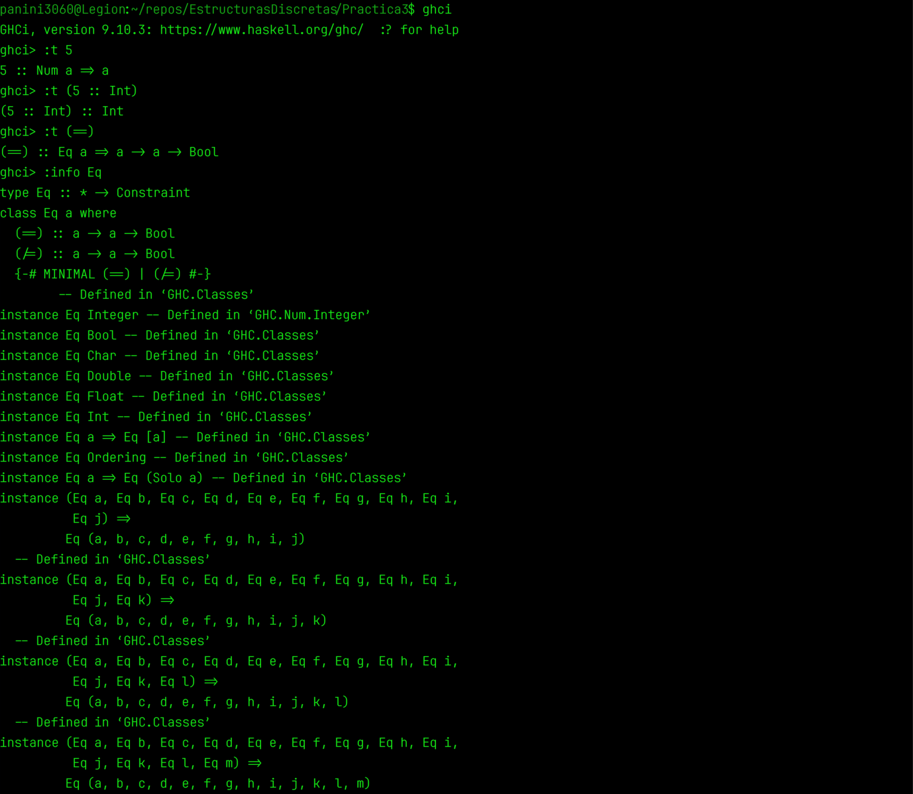
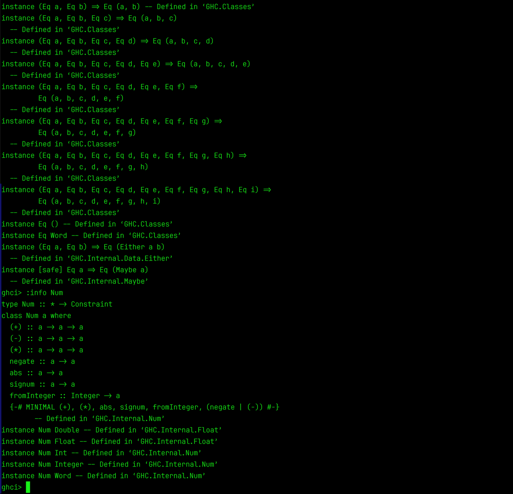

## Práctica 3: Mis tipos de datos y listas por compresión

# Alumno: Alvarado Ibáñez Bruno
# Asignatura: Estructuras Discretas (Laboratorio)

---

## Objetivo de la práctica

El objetivo de esta práctica es introducir y poner en práctica dos conceptos fundamentales de Haskell: la creación de tipos de datos propios mediante la palabra reservada `data`, y el uso de listas por comprensión para procesar colecciones de valores de manera declarativa. A través de los ejercicios se trabajó con constructores, pattern matching, funciones auxiliares, módulos y recursión básica.

La práctica también tiene como propósito distinguir entre clases de tipo (como `Num`) y tipos concretos (como `Int`), comprender la importancia de las firmas de tipo, y continuar utilizando GHCi, Git y GitHub como herramientas de desarrollo y control de versiones.

---

## Ejercicio 1: Diferencia entre `Num` e `Int`

Pregunta: ¿Cuál es la diferencia entre `Num` e `Int`?

Respuesta:

La diferencia principal es que `Num` es una clase de tipo (una interfaz) mientras que `Int` es un tipo concreto:

- `Num` es una clase de tipo que agrupa a todos los tipos numéricos de Haskell. Define operaciones comunes como `(+)`, `(-)`, `(*)`, `negate`, `abs`, `signum` y `fromInteger`. Los tipos `Int`, `Integer`, `Float`, `Double` y `Rational` son instancias de `Num`. Cuando escribimos un literal como `5`, Haskell infiere que su tipo es `Num a => a`, es decir, "cualquier tipo que sea instancia de `Num`". El tipo concreto se decide después, según el contexto.

- `Int` es un tipo concreto de enteros con precisión fija (normalmente 64 bits en sistemas modernos). Tiene un rango limitado y operaciones específicas. Es una de las posibles instancias de `Num`, pero no es `Num` en sí.

---

## La Chivita Recursiva
La canción Sal de ahí, chivita, chivita es un ejemplo perfecto de recursión ya que cada estrofa añade un nuevo “llamado” (el lobo, el palo, el fuego, el agua…) que depende del anterior para resolver un problema (sacar a la chiva). Esto es idéntico a una función recursiva: se invoca a sí misma con un subproblema y llama al siguiente elemento, hasta llegar a un caso base. La estructura repetitiva de la letra donde cada nuevo verso recita todos los anteriores refleja cómo la pila de llamadas va acumulando contextos hasta que se alcanza la solución. Así, la canción ilustra visual y auditivamente la esencia de la recursión: resolver un problema llamandose así mismo en una versión más simple de sí mismo, con un punto de parada claro.


---
## Ejemplo en GHCi:





---

## Tiempo requerido

El tiempo total requerido para realizar la práctica fue de aproximadamente 4 horas.
Herramientas utilizadas

## Ejercicio favorito
De entre todos los ejercicios que realizé, puedo decir que el ejercicio número 2 fue el que más me llamó la atención y el que disfrute más programando, aun cuando no hubiera salido a la primera, me gusto el resultado de la solución.

---

## Lineamientos de la práctica

Durante la implementación de las funciones se siguieron los lineamientos establecidos para la práctica. Las funciones se desarrollaron utilizando únicamente las operaciones y funciones básicas permitidas (+, *, /, mod, sqrt, if-then-else, y en su caso sum o length). Se evitó el uso de funciones de orden superior como map y filter, así como funciones predefinidas como even, odd y gcd.

Cada función implementada fue acompañada por un comentario que describe su propósito, firma de tipo y ejemplo de uso. También se utilizó control de versiones mediante Git, realizando un mínimo de tres commits atómicos durante el desarrollo de la práctica, siguiendo la convención de commits semánticos (feat:, fix:, docs:, etc.).

De acuerdo con los lineamientos, la práctica cuenta con este archivo README.md, en el que se documentan el objetivo, el tiempo requerido, el ejercicio favorito y los comentarios relevantes sobre el desarrollo. También se realizó la carga y ejecución del archivo .hs mediante GHCi y se incluye una captura de pantalla como evidencia.

## Desarrollo de la práctica

Durante la práctica se implementaron diferentes funciones en Haskell para resolver problemas relacionados con tipos de datos propios, listas por comprensión, módulos y recursión.

En una primera parte se definió el tipo de dato Plazo, con dos constructores (Dias Int y Meses Int), y se implementaron funciones auxiliares para convertir un plazo a días y para asignar la tasa de interés correspondiente. A partir de estas piezas se implementó la función cetes, que calcula el monto final de una inversión según la fórmula de interés simple utilizada por CETES, y la función mensajeCetes, que devuelve un mensaje descriptivo con el rendimiento bruto y el monto acumulado.

Posteriormente se trabajó con listas por comprensión. Se implementó negativos, que cuenta los números negativos de una lista, y soloPares, que filtra los números pares. Para esta última se creó un módulo aparte llamado EsParBit.hs, que exporta la función esParBit y se importa desde practica3.hs, cumpliendo con el desafío del ejercicio 5.

Finalmente se implementaron funciones más elaboradas: primos, que devuelve los números primos de una lista usando una función auxiliar esPrimo definida con listas por comprensión, y coprimos, que devuelve los números coprimos con n usando una implementación recursiva del algoritmo de Euclides para el máximo común divisor (mcd) y una función auxiliar esCoprimo.

Todas las funciones fueron implementadas en el archivo practica3.hs (y esParBit en EsParBit.hs) y cuentan con sus respectivas firmas de tipo y comentarios.
Pruebas con GHCi

Para comprobar el funcionamiento de las funciones se utilizó GHCi. El archivo practica3.hs fue cargado desde la terminal (junto con el módulo EsParBit.hs) y posteriormente se realizaron diferentes pruebas para verificar los resultados obtenidos.

Entre las pruebas realizadas se encuentran:

    *Cálculo del monto final de CETES para plazos de 28, 182 y 364 días, y para plazos inválidos.

    *Generación del mensaje descriptivo con mensajeCetes.

    *Conteo de negativos y filtrado de pares en listas de enteros.

    *Filtrado de primos en listas como [1..20].

    *Cálculo de coprimos para números como 10, 8 y 7

---

## Estado final de la práctica

Al finalizar la práctica se implementaron las funciones solicitadas en el archivo practica3.hs, junto con el módulo EsParBit.hs para el ejercicio 5. Las funciones cuentan con sus respectivas firmas de tipo y comentarios, y fueron probadas mediante GHCi.

La práctica también cuenta con su documentación correspondiente mediante este archivo README.md y con el historial de versiones requerido mediante commits atómicos y semánticos. La evidencia de las pruebas realizadas en GHCi se incluye en este mismo documento.

## Estructura de la práctica

La carpeta correspondiente a la práctica contiene el archivo con las funciones implementadas, el módulo auxiliar para esParBit, este documento de documentación y las capturas de pantalla correspondientes a las pruebas realizadas mediante GHCi.

```text
Practica3/
├── Practica3.hs
├── EsParBit.hs
├── README.md
├── ghci1_ejercicio_practica3.png
└── ghci2_ejercicio_practica3.png

---

